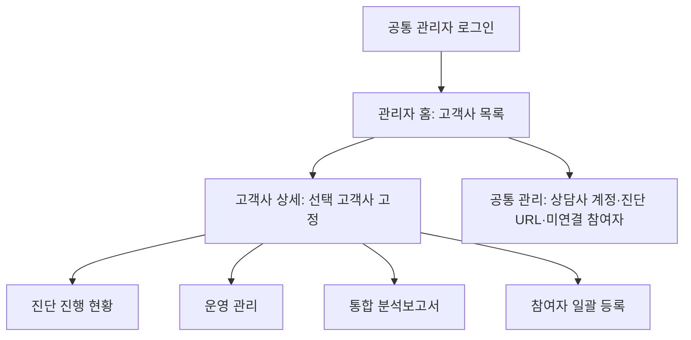
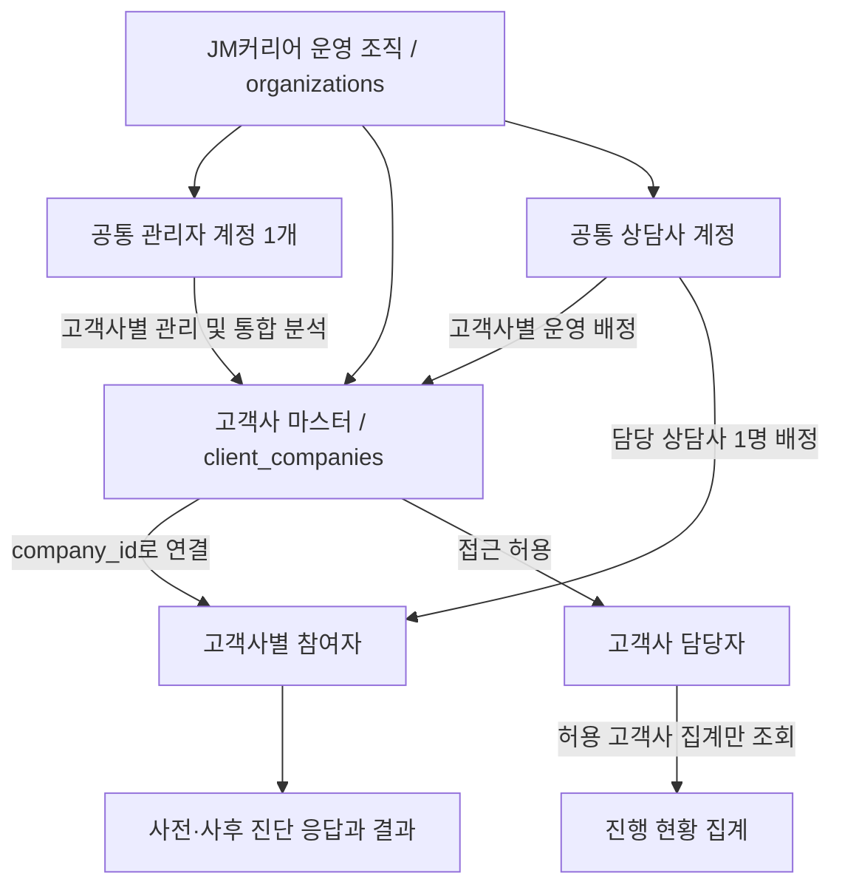

# 세컨플래닝 관리자 고도화 — 변경 범위 명세서

> 문서 상태: **기획 기준안 / 구현 승인 아님**  
> 작성 기준: 2026-11-16 (KST)  
> 저장소: [earingjin/secondcareer](https://github.com/earingjin/secondcareer)  
> 확인 브랜치: `fix/counselor-registration-auth-contract`  
> 기준 커밋: [`081a9564a222a5af27b49594fea2de98164e9068`](https://github.com/earingjin/secondcareer/commit/081a9564a222a5af27b49594fea2de98164e9068)  
> 비교 대상: `main` (`52ab1092904dba41372222cf91ab0530e98efa48`)  
> 근거: 위 기준 커밋의 실제 파일과 `docs/requirements.md`, `docs/implementation-status.md`, `AGENTS.md`를 읽기 전용으로 확인. **운영 DB 상태, 배포 버전, 실제 이용자 흐름은 검증하지 않음.**

## 1. 목적 및 확정된 정책

이번 작업의 목적은 기존 진단·계산·보고서 기능을 보존하면서 **JM커리어 통합 관리자가 고객사별 데이터를 혼동 없이 관리**할 수 있도록 관리자 정보 구조와 데이터 조회 범위를 바꾸는 것이다.

| 항목 | 확정된 정책 |
|---|---|
| 관리자 계정 | JM커리어의 정규직 관리자들이 필요시 하나의 공통 관리자 계정을 사용. 관리자 계정의 다중 발급·관리 화면은 요구하지 않음 |
| 관리자 홈 | 기존 고객사 목록을 가장 앞에 표시 |
| 고객사 선택 | 고객사 목록 클릭 → **별도 고객사 상세 관리 페이지(B안)**로 이동. 상단에 현재 고객사명과 고객사 변경 기능 |
| 고객사별 기능 | 진단 진행 현황, 운영 관리, 통합 분석보고서, 참여자 일괄 등록 |
| 공통 기능 | 상담사 계정 관리, 내담자 진단 접속 주소, 미연결 참여자 관리 |
| 참여자 일괄 등록 | 고객사 상세 페이지에서 **선택된 고객사 한 곳에만** 등록. 다른 고객사 혼입 차단 |
| 미연결 참여자 | 공통 관리에서 별도 표시하고 관리자가 확인 후 올바른 고객사에 연결. 기업명 유사성으로 자동 연결하지 않음 |
| 기존 기능 | 참여자·상담사·고객사 담당자 역할과 보고서 권한 유지. 점수 계산·9개 통합 분석 지표·보고서 인쇄 로직 보존 |

### 이번 작업의 비범위

- 기존 진단 문항·점수 환산·판정 경계·코멘트·키워드·보고서 분석식 변경
- 사용자 역할 확대(참여자에게 개인 결과 열람 부여, 고객사 담당자에게 원문·개인 보고서 부여 등)
- 별도의 고객사별 진단 접속 URL 신설
- 복수 관리자 계정 발급 또는 개인별 관리자 활동 추적을 이미 구현된 것으로 간주
- 운영 DB 직접 적용, Edge Function 배포, 실계정 생성, GitHub 커밋·푸시
- 미연결 참여자의 자동 일괄 이관이나 기업명 자동 매칭

## 2. 관리자 정보 구조(IA)

**선택 상태 규칙**

1. 목록 행을 선택하면 서버의 `client_companies.id`를 기준으로 고객사 상세 페이지에 진입한다. 기업명은 표시용이며 조회 식별자로 사용하지 않는다.
2. 고객사 상세 페이지의 네 메뉴는 항상 같은 `companyId`를 사용한다. 선택이 없는 경우 해당 기능을 전체 조직 범위로 자동 전환하지 않는다.
3. 고객사 전환 시 이전 고객사의 조회 데이터·인쇄용 DOM·개별 결과·선택 상태를 제거하고 새 고객사를 조회한다. 이전 요청의 지연 응답이 새 화면에 표시되지 않아야 한다.
4. 참여자 일괄 등록에 미입력 데이터나 등록 작업이 진행 중이면 고객사 이동 전에 확인하거나 완료될 때까지 전환을 제한한다.
5. 비활성 고객사는 기존 데이터 조회를 허용할 수 있으나 신규 일괄 등록은 차단한다(상세 검증 기준은 설계·테스트에서 명시).
6. 공통 기능은 특정 고객사 선택과 무관하게 접근할 수 있어야 한다.

## 3. 네 사용자 역할의 연결 구조

### 3.1 데이터 관계

**중요한 관계 구분**

- `organizations`는 JM커리어와 같은 운영 조직 범위이며 `client_companies`는 그 안에서 관리하는 **고객사**이다.
- `client_company_counselors`의 고객사–상담사 **운영 배정**과 `participants.counselor_user_id`의 **참여자 담당 상담사**는 다른 관계다. 운영 배정 변경만으로 기존 참여자의 담당 상담사·진단·보고서가 자동 변경되어서는 안 된다.
- 한 상담사가 여러 고객사에 운영 배정될 수 있으며, 참여자는 하나의 소속 고객사 `company_id`에 연결된다. 미연결자는 `company_id IS NULL`이다.
- 고객사 담당자는 `company_manager_accounts`와 `company_manager_access`를 통해 허용 고객사에만 접근한다. 여러 고객사 접근이 허용된 담당자에게도 **개인 응답·개인 보고서는 제공하지 않는다.**

### 3.2 역할별 기능·권한 매트릭스

| 업무 | 통합 관리자 | 상담사 | 내담자/참여자 | 고객사 담당자 |
|---|---|---|---|---|
| 고객사 등록·수정·비활성화 | 조직 범위 | 불가 | 불가 | 불가 |
| 상담사 계정 발급 | 공통 관리 | 불가 | 불가 | 불가 |
| 고객사별 상담사 운영 배정 | 가능 | 불가 | 불가 | 불가 |
| 고객사별 참여자 일괄 등록 | **선택 고객사에만** | 불가 | 불가 | 불가 |
| 담당 참여자 직접 등록 | 관리 가능 | 기존 본인 담당 등록 방식 유지 | 불가 | 불가 |
| 사전·사후 진단 응답 | 현황 조회 | 담당자 안내·허용 | **본인 응답** | 불가 |
| 개인 결과보고서 5쪽/3쪽 | 조직·선택 고객사 내 조회·인쇄 | 본인 담당 참여자 조회·인쇄 | 직접 조회 불가 | 조회 불가 |
| 통합 9개 분석보고서 | 선택 고객사에 한해 조회·인쇄 | 접근 불가 | 접근 불가 | 접근 불가 |
| 진단 진행 현황 | 고객사별 상세 | 본인 담당자 | 본인 상태 | **허용 고객사의 집계만** |
| 미연결 참여자 고객사 연결 | 공통 관리에서 승인·처리 | 임의 연결 불가 | 불가 | 불가 |

**역할별 연결 흐름**

1. **통합 관리자**가 고객사를 등록하고 조직 공통 상담사 중 해당 고객사 운영 상담사를 배정한다.
2. 관리자가 고객사 상세의 **참여자 일괄 등록**을 실행하면 해당 고객사 ID가 고정되고, 그 고객사에 운영 배정된 상담사만 담당자로 지정할 수 있다. 서버는 등록마다 조직·활성 고객사·상담사 배정 관계를 재확인한다.
3. **내담자**가 공통 진단 주소에서 본인 계정으로 로그인하여 사전 진단을 작성·제출한다. 응답 저장과 결과 계산·보호는 기존 서버 흐름을 유지한다.
4. **상담사**는 본인에게 배정된 내담자만 조회하여 개인 보고서를 확인·인쇄하고, 기존 정책대로 사후 진단을 허용한다.
5. **고객사 담당자**는 별도 계정으로 로그인하여 자신에게 허용된 고객사의 완료율 등 **집계 정보만** 확인한다. 관리자용 9개 통합 분석과 개인별 응답은 볼 수 없다.
6. **통합 관리자**는 선택 고객사 상세에서 진행 상태·운영 목록·통합 분석을 확인한다. 공통 진단 URL은 고객사 선택과 무관하게 동일하다.

## 4. 실제 코드 기준 변경 범위

구분: **유지** = 원칙적으로 내용 변경 금지 / **수정** = 이번 요구사항에 필요한 변경 / **조건부** = 실제 연결·테스트 중 필요성이 확인되면 최소 변경 / **신규** = 기존 코드에 독립적으로 완성된 기능이 확인되지 않음.

### 4.1 기존 파일 **그대로 유지** (핵심 보존 대상)

| 파일·경로 | 보존할 기능 | 이유 |
|---|---|---|
| `legacy/index.original.html`, `legacy/SHA256.txt` | 원본 대조 기준 | 저장소 `AGENTS.md`에 수정·삭제 금지 명시 |
| `src/js/00-question-defs.js`, `src/js/01-areas.js`, `src/js/02-eval-config.js`, `src/js/05-engine.js` | 문항 정의, 영역, 환산, 판정, 계산 엔진 | 원본 계산 결과 보존 |
| `src/data/feedback-comments.js`, `src/data/feedback-keywords.js` | 코멘트·인생키워드 데이터 및 연결 코드 | 문구·매핑 변경은 별도 승인 절차 |
| `supabase/functions/secondcareer-assessment/js/*`, `.../data/*` | 서버용 계산·문항·코멘트 복제본 | 관리자 UI 구조 변경과 무관한 계산 로직 |
| `supabase/functions/secondcareer-assessment/index.ts` | 내담자 사전·사후 응답 저장, 상담사 역할·담당 권한 및 보고서 요청 | 역할별 기존 저장·진단 계약 보존 |
| `supabase/functions/secondcareer-assessment/shared/report.ts`, `shared/profile.js` | 상담사용 5쪽·고객용 3쪽 개인 보고서 생성 | 9개 통합 분석과 별개; 출력 보존 |
| `supabase/functions/_shared/admin-aggregate.ts`의 `areaAnalysis`, `factorAnalysis`, `satisfactionAnalysis`, `stabilityAnalysis`, `complaintAnalysis`, `consultingAnalysis`, `improvementAnalysis`, `firstSessionAnalysis`, `feedbackAnalysis` | 관리자 통합보고서 **9개 분석 계산** | 계산식 변경 금지. 같은 파일의 **모집단 조회 부분만** 수정 가능 |
| `src/live/admin-aggregate-view.js`의 `r1View`~`r9View`, `tabParts`, `adminAggregatePrintView` 및 `src/css/admin-aggregate-print.css` | 9개 분석 화면과 전체 인쇄 레이아웃 | 신규 화면 재작성 대신 기존 렌더러 사용 |
| `supabase/functions/secondcareer-login/index.ts`, `src/live/login-view.js` | 역할별 로그인 | 관리자 한 계정 운영은 운영 정책. 인증 방식 재구현 불필요 |
| `src/live/admin-counselors.js`, `supabase/functions/secondcareer-admin-counselors/index.ts` | 조직 공통 상담사 계정 발급·조회 | 고객사별 상세로 범위를 축소하지 않음 |
| `supabase/functions/secondcareer-account/index.ts`의 `organizations.assessment_url` 처리 | 공통 진단 주소 조회·수정 | 고객사마다 별도 URL을 만들지 않음 |
| `supabase/functions/secondcareer-company-manager-progress/index.ts`, `src/live/company-manager-dashboard.js` | 고객사 담당자의 허용 고객사 ID별 집계 | 별도 역할 권한·집계 응답 계약 유지 |
| `tests/golden/*`, `tests/contract/*`, 기존 계산·인쇄 기준선 | 기존 정답/회귀 기준 | 변경을 통과시키려고 기준선을 먼저 바꾸지 않음 |

### 4.2 **수정 필요** — 기존 코드 재사용하면서 연결 방식만 변경

| 파일 | 현재 역할 / 확인된 사실 | 최소 변경 범위 | 변경 금지 부분 |
|---|---|---|---|
| `src/live/app.js` | 관리자 홈에 모든 섹션 나열, 진행·운영 조회, 통합 인쇄, 등록 컴포넌트 연결 | 홈과 고객사 상세 라우팅, 선택 `companyId` 상태, 네 메뉴 간 선택 유지, 화면 전환·비동기 요청 취소/폐기, 공통 기능 분리 | 내담자 저장·제출·사후 흐름, 기존 역할 검사 |
| `src/live/admin-companies.js` | 조직 내 고객사 마스터 목록·등록·상세·상태 전환 | 목록 행 선택을 고객사 상세 진입과 연결; 기존 고객사 상세/정보 수정 기능 유지 | 마스터 CRUD·상담사 배정의 기존 검증 로직 |
| `src/live/api.js` | 프런트와 Edge Functions의 통신 계층 | 고객사별 API에 선택 `companyId` 전달, 응답 범위 확인, 미연결 조회/연결 신규 API 추가 | 로그인·토큰 저장·재발급 및 기존 역할별 API 계약 |
| `src/live/admin-progress-view.js` | 조직 전체 집계 UI | 선택 고객사의 진행·완료 데이터만 보여 주도록 입력·제목·빈 상태 변경 | 상태 정의 `notStarted`/`draft`/`submitted`, 완료율 기준 |
| `supabase/functions/secondcareer-admin-progress/index.ts` | `participants.company_name`별 조직 집계 | 서버에서 관리자 조직 확인 후 `participants.company_id = companyId` 범위만 조회하도록 요청·응답 계약 확장 | 사전/사후 단계 및 완료율 계산 의미 |
| `src/live/admin-directory-view.js` | 조직 전체 참여자·상담사 목록과 기업명 필터 | 선택 고객사 참여자 목록 및 검색/상태 필터로 재구성 | 관리자 개인보고서 접근 권한, 참여자 소유·담당 관계 |
| `supabase/functions/secondcareer-admin-directory/index.ts` | 조직 내 기업명 문자열로 목록 구성 | 서버에서 고객사 ID에 해당하는 참여자만 조회; 해당 고객사 참여자 담당 상담사를 정확히 표시 | 다른 조직 접근 차단, 반환 개인정보 최소화 |
| `supabase/functions/secondcareer-admin-aggregate/index.ts` | `company` 기업명 필터로 통합 분석 호출 | `companyId` 입력을 서버에서 조직·고객사 마스터와 검증, 해당 고객사 모집단 요청 | 9개 분석 함수 호출·의미 |
| `supabase/functions/_shared/admin-aggregate.ts` **모집단 조회부만** | `loadPairedPopulation`에서 `company_name`으로 참여자 필터 | `participants.company_id`로 모집단 선정. 기존 pre/post 완료 조건과 분석 함수에 전달하는 데이터 형태 보존 | 9개 계산 함수, 반올림·분모·순위·집계식 |
| `src/live/admin-aggregate-view.js` **선택 UI/검증 부분만** | 보고서 안에 자체 기업명 선택 `<select>`가 있음 | 외부 고객사 선택에 동기화, 내부 '전체' 전환 제거, 고객사명·ID·분석 기준 표시, 인쇄 전 선택 불일치 차단 | `r1View`~`r9View`, 9개 인쇄 렌더러 |
| `src/live/participant-registration.js` | 관리자에 '미연결/연결' 모드 및 고객사 선택이 공존 | **고객사 상세에서 호출할 때만** 연결 모드를 강제하고 고객사 선택 잠금; 선택 고객사만 등록 확인. 상담사 직접 등록 경로는 기존 유지 | 파일 입력·중복·등록 결과·임시 비밀번호 노출 제한 정책 |
| `supabase/functions/secondcareer-admin-report/index.ts` | 관리자 조직 범위의 개인 보고서 조회 | 고객사 상세 문맥에서는 요청된 고객사 ID와 해당 참여자 연결 여부를 함께 재검증하는 계약 검토·필요 시 최소 수정 | 기존 개인 보고서 생성 방식과 5쪽/3쪽 내용 |

### 4.3 **조건부 변경** — 먼저 기존 코드로 해결 가능한지 확인

| 파일·영역 | 조건 | 원칙 |
|---|---|---|
| `src/live/registration-input.js` | 고정 고객사 문맥에서 기존 `companyMode='linked'` 검증만으로 충분하지 않을 때 | 새 검증 중복 작성 금지. 기존 행별 기업명 불일치·중복 상담사·최대 인원 검증 재사용 |
| `src/live/admin-company-managers.js`, `supabase/functions/secondcareer-admin-company-managers/index.ts` | 고객사 상세의 운영 관리 탭 안으로 고객사 담당자 계정 관리 UI를 이동할 때 | 이미 고객사 ID 기준이므로 업무 기능·발급 계약은 유지하고 배치만 조정 |
| `supabase/functions/secondcareer-admin-companies/index.ts` | 기존 고객사 마스터 상세의 연결 인원/조회 기능을 재사용할 때 | 마스터 CRUD는 유지. 미연결자 연결 변경을 무리하게 이 함수에 끼워 넣지 말고 별도 책임 검토 |
| `supabase/functions/_shared/admin-access.ts` | 신규 고객사 ID 검증이 공통화에 유익할 때 | 서버의 기존 관리자·조직 스코프 검사 보존, 필요 최소한의 헬퍼만 추가 |
| `src/index.html`, `src/css/*` | 고객사 상세의 탭/모바일 화면 스타일 추가가 필요한 경우 | 기존 설문·보고서 CSS 변경 최소화, 화면 회귀 검증 |
| `docs/requirements.md`, `docs/decisions.md`, `docs/implementation-status.md` | 구현 범위 확정 후 해당 사용자 결정·검증 결과 반영 | 사용자가 승인한 해당 항목만 갱신, 과거 구현 기록 지우지 않음 |

### 4.4 **신규 필요** — 현재 완성된 구현으로 보지 말 것

| 신규 기능/후보 파일 | 필요한 책임 | 사전 조건 |
|---|---|---|
| 공통 관리의 '미연결 참여자' 전용 화면 (`src/live/` 하위 신규 모듈 후보) | `company_id IS NULL` 참여자 목록, 검색·페이지·기존 기업명·담당 상담사·연결 대상 선택·최종 확인 | 관리자만 접근. 기존 값은 수정하지 않고 표시 |
| 미연결 참여자 **읽기 전용 조회** Edge Function 후보 | 서버 검증 관리자 조직 내 `company_id IS NULL` 목록과 필요한 최소 정보 반환 | 조직 경계·페이지네이션·개인정보 최소화 |
| 미연결 참여자 **연결 확정** Edge Function/RPC 후보 | 서버에서 특정 `participantId`를 선택 `companyId`에 연결. 동일 조직·현재 NULL·고객사 유효·동시 수정·변경 이력 검사 | DB 제약/RLS/현재 운영 스키마 점검 후 **별도 SQL·배포 승인** |
| 관련 신규 테스트 | 타 조직·없는 ID·비활성 고객사·중복 요청·두 관리자 동시 실행·기업명 불일치·인쇄·전환 검증 | 구현과 동일 단계에서 작성 |

> 근거: 현재 `secondcareer-admin-companies`는 고객사 상세에서 **연결/미연결 인원수**를 조회한다. `supabase/proposals/participant-company-link-preview.sql`은 이관 후보 검토용이며 실제 기존 참여자를 안전하게 연결하는 관리자 UI+완료 API가 있다고 단정할 수 없다. `supabase/proposals/*.sql`은 자동 적용되는 코드가 아니며 운영 DB에 적용됐다는 증거도 아니다.

## 5. 서버 데이터 계약과 안전 규칙

1. **단일 기준:** 고객사별 기능의 입력 키는 `companyId`(=`client_companies.id`), 조회·관계 조인의 기준은 `participants.company_id`. `participants.company_name`은 표시·과거 데이터 참고용이며 자동 매칭 키로 사용하지 않는다.
2. **조직 경계:** 서버가 로그인 계정 프로필에서 `organization_id`를 확정하고, 해당 조직에 속한 고객사 ID인지 매 요청 검증한다. 클라이언트가 전달한 조직 ID만으로 권한을 부여하지 않는다.
3. **선택 필수:** 고객사 상세의 네 기능은 `companyId`가 없거나 잘못됐을 때 조직 전체 데이터를 반환하지 않는다(안전한 오류 처리). `전체 고객사`는 관리자 홈의 목록 탐색에서만 허용한다.
4. **일괄 등록 고정:** 선택된 활성 고객사 ID가 모든 행의 최종 등록 대상. 파일에 다른 기업명이 들어오면 오류. 빈 기업명은 서버의 고객사 마스터 명칭 사용. 해당 고객사에 운영 배정된 상담사만 지정할 수 있다. 서버에서도 재검증한다.
5. **미연결자 연결:** 기존 `company_id IS NULL` 참여자는 사용자 확인 후 하나씩 연결하는 것을 기본값으로 한다. 연결 전에는 고객사별 진행·운영·통합 분석에서 제외한다. 이력·중복 요청·동시 수정 충돌을 추적한다.
6. **기존 데이터 보존:** 미연결 참여자의 기존 `company_name`, 진단 응답, 담당 상담사, 결과 및 이력은 임의로 변경하지 않는다. 연결 후 표시할 고객사명은 마스터에서 조회한다. 과거 `company_name`을 실제로 정규화·덮어쓸지는 **별도 승인 결정**이다.
7. **보고서 모집단:** 현재 보고서의 사전·사후 모두 제출 조건, 만족도 응답자별 모집단, 첫 회기 기대 분석 모집단 등은 바꾸지 않는다. 단지 모집단의 **소속 고객사 선정 단계**만 ID 기준으로 바꾼다.
8. **고객사 담당자:** 기존 `company_manager_access`에 허용된 고객사의 집계만. 관리자 통합 9개 분석/개인 응답/개인 보고서로 권한을 확장하지 않는다.
9. **개인정보:** 이름·연락처·로그인 ID·내담자별 응답·보고서는 허용된 역할과 필요한 화면에만 전달한다. 요청 본문/URL/로그에 비밀번호를 포함하지 않는다.
10. **공통 관리자 계정:** 현재 운영 정책은 공통 ID 하나. 공유 로그인에는 개인 행위자를 식별할 수 없다는 한계가 있으므로 비밀번호 관리·사용자 교체·조작 이력 보호를 별도 운영 통제로 다룬다. 이번 요구사항만으로 인증 구조를 변경하지 않는다.

## 6. 단계별 구현·승인 게이트 (향후 개발 지시서의 분할 기준)

| 단계 | 수행 범위 | 완료 판단 / 다음 단계 조건 |
|---|---|---|
| **0. 읽기 전용 사전 점검** | 로컬·원격 HEAD, 미커밋 변경, 요구사항, 운영 DB의 `client_companies`/`participants.company_id`/연계 SQL/RLS 실제 존재 여부 확인 | 실제 적용·미적용·미검증 목록 작성. DB 변경은 수행하지 않음 |
| **1. 관리자 화면 구조** | 고객사 목록 → 고객사 상세 페이지(B안), 네 메뉴 및 공통 관리 분리, 선택 ID 상태, 전환 보호 | 화면·모바일·브라우저 검증. 임의 운영 데이터 쓰기 없음 |
| **2. 고객사별 읽기 API** | 진행 현황·운영 관리·개인 보고서의 고객사 범위, 서버 조직 검증 및 응답 계약 | A 고객사 선택 시 B 고객사 데이터/응답 미포함. 기존 역할 회귀 |
| **3. 참여자 등록 고정** | 기존 연결 등록 모드 재사용, 상세 화면에서 고객사 고정, 파일 불일치 차단, 배정 상담사 검증 | 다른 고객사에 등록되는 경로 없음. 서버 등록/복구 회귀 |
| **4. 미연결 참여자 관리** | 공통 목록 조회 → 후보 확인 → 연결 변경의 독립 기능 설계·구현 | 적용할 DB/RPC·RLS·이력 먼저 별도 승인, 동시성·타 조직 검증 |
| **5. 통합 분석보고서 연결** | ID 기준 모집단 조회로 교체, 기존 9개 계산/렌더/인쇄 재사용 | 동일 참여자 집합에서는 기존 수치·인쇄 결과 유지. 연결·미연결 경계 검증 |
| **6. 종합 검증/반영 준비** | 기존 전체 테스트 + 신규 시나리오, 문서와 검증 근거 갱신 | 사용자가 검토한 뒤 커밋·푸시·DB 적용·배포 여부를 각각 승인 |

## 7. 필수 수용 테스트

| 번호 | 검증 시나리오 | 기대 결과 |
|---|---|---|
| T01 | 관리자 홈에서 A사 선택 | A사 전용 상세가 열리고 회사명/ID 일관 표시 |
| T02 | A사에서 진행→운영→보고서→등록 이동 | 네 메뉴 모두 동일한 A사 ID 사용 |
| T03 | A사 상세에서 B사로 변경 | A사 데이터·선택·대기 요청·인쇄 잔여물 없음 |
| T04 | 고객사 선택값 누락/변조/타 조직 ID로 API 직접 호출 | 조직 전체로 우회 조회하지 않고 요청 거부 |
| T05 | A/B 같은 기업명 또는 유사 표기 존재 | 다른 고객사 데이터가 혼입되지 않음 |
| T06 | A사 참여자 + 미연결자 존재 | `company_id=A`만 A사의 현황·운영·통합 분석에 포함 |
| T07 | 미연결 참여자 연결 승인 및 재조회 | 승인한 대상만 A사에 반영, 기존 응답·담당·결과 유지 |
| T08 | 미연결 참여자를 동시에 두 고객사로 연결 시도 | 중복/충돌을 안전하게 거부하고 단일 결과 확정 |
| T09 | A사 상세에서 B사 기업명이 포함된 엑셀 가져오기 | 불일치 행 오류, B사로 자동 변경되거나 등록되지 않음 |
| T10 | A사에 배정되지 않은 상담사로 신규 등록 | 화면과 서버 모두 차단 |
| T11 | A사가 비활성 상태 | 기존 정보 조회 정책은 유지하되 신규 등록 불가 |
| T12 | 상담사의 기존 본인 담당 내담자 등록·사전/사후 승인·개인 보고서 | 새 관리자 UI와 무관하게 정상 유지 |
| T13 | 고객사 담당자로 개인 보고서·관리자 분석·다른 고객사 호출 | 서버에서 거부하고 개인 식별·원문 정보 없음 |
| T14 | 동일한 A사 참여자 모집단으로 이전/이후 9개 분석 비교 | 기존 계산식·분모·반올림·순위·빈 데이터 처리 일치 |
| T15 | A사 통합 분석 9개 항목 전체 인쇄 | 회사명·모집단·값 일치, 기존 페이지/레이아웃 유지 |
| T16 | 공통 상담사 계정과 진단 접속 URL 접근 | 특정 고객사 선택 여부와 무관하게 조직 공통으로 동작 |

권장 회귀 테스트 파일: `tests/live/admin-companies-browser.spec.mjs`, `admin-progress-browser.spec.mjs`, `admin-progress-server.spec.mjs`, `admin-directory.spec.mjs`, `admin-aggregate*.spec.mjs`, `admin-report.spec.mjs`, `registration-browser.spec.mjs`, `registration-server.spec.mjs`, `company-link-server.spec.mjs`, `company-manager-*.spec.mjs`, `counselor-registration-*.spec.mjs`. 기본 정답 확인에는 `npm run test:golden`, `npm run test:dist`를 활용하되 **이번에 실행했다는 뜻은 아니다.**

## 8. 구현 전 확인이 필요한 실제 환경 항목

1. **DB 적용 여부:** 저장소 문서에는 일부 `supabase/proposals/*.sql`이 **미적용 제안**으로 기재되어 있다. 현재 운영 DB에 `participants.company_id`, 고객사 마스터, FK·RLS·등록 RPC가 실제 존재하는지 읽기 전용으로 확인해야 한다. 코드 존재와 실제 적용은 다르다.
2. **계정·기능 플래그:** 고객사 담당자, 참여자 등록 등 실제 운영 환경의 기능 플래그와 서버 배포 버전은 미검증이다. 이번 명세는 배포 완료 판정이 아니다.
3. **기존 미연결 이관:** `participant-company-link-preview.sql`은 후보 검토용. 실제 연결 버튼·서버 권한·동시성·감사 기록 계약은 구현 전에 별도로 확정한다.
4. **고객사 전환 시 미저장 상태:** 일괄 등록의 미저장 입력 및 결과 내보내기·보호 방식은 기존 UX를 확인하고 전환 확인 문구를 설계한다.
5. **보존 우선 원칙:** 기존 권한·계산·보고서 테스트가 실패하면 테스트 기준을 고치는 대신 변경 코드를 조사하고 사용자에게 영향/대안을 보고한다.

## 9. VS Code AI 협업 지침의 범위

- 사용자의 기본 개발 방식: **VS Code에서 Codex·Claude Code로 로컬 수정 → 로컬 기능·회귀 테스트 → 사용자 검토 → 승인된 범위로 GitHub 반영**.
- 다음 단계의 개발 지시서는 **단계별로 별도 작성**한다. 지금 문서는 Codex/Claude에게 곧바로 모든 구현을 수행하도록 위임하는 지시서가 아니다.
- 각 지시서는 작업 전 `git status`, 현재 브랜치/HEAD, 미커밋 변경, 허용 파일, 검증 명령, 관련 요구사항 ID를 확인하도록 한다.
- 사용자의 별도 승인 없는 **SQL 실행·RLS 수정·Edge 배포·실데이터 쓰기·커밋·푸시**는 하지 않는다. 코드를 작성하는 승인과 운영 시스템을 변경하는 승인은 분리한다.

## 10. 주요 코드 근거 링크

- [관리자 화면과 전환: `src/live/app.js`](https://github.com/earingjin/secondcareer/blob/081a9564/src/live/app.js)
- [고객사 마스터 UI: `src/live/admin-companies.js`](https://github.com/earingjin/secondcareer/blob/081a9564/src/live/admin-companies.js)
- [일괄 등록 UI: `src/live/participant-registration.js`](https://github.com/earingjin/secondcareer/blob/081a9564/src/live/participant-registration.js)
- [등록 행 검증: `src/live/registration-input.js`](https://github.com/earingjin/secondcareer/blob/081a9564/src/live/registration-input.js)
- [관리자 진단 현황 API](https://github.com/earingjin/secondcareer/blob/081a9564/supabase/functions/secondcareer-admin-progress/index.ts)
- [관리자 운영 관리 API](https://github.com/earingjin/secondcareer/blob/081a9564/supabase/functions/secondcareer-admin-directory/index.ts)
- [통합 분석 진입 API](https://github.com/earingjin/secondcareer/blob/081a9564/supabase/functions/secondcareer-admin-aggregate/index.ts)
- [통합 분석 모집단·9개 분석: `_shared/admin-aggregate.ts`](https://github.com/earingjin/secondcareer/blob/081a9564/supabase/functions/_shared/admin-aggregate.ts)
- [통합 분석 화면·인쇄](https://github.com/earingjin/secondcareer/blob/081a9564/src/live/admin-aggregate-view.js)
- [고객사 담당자 집계(참고할 ID 검증 패턴)](https://github.com/earingjin/secondcareer/blob/081a9564/supabase/functions/secondcareer-company-manager-progress/index.ts)
- [현행 요구사항](https://github.com/earingjin/secondcareer/blob/081a9564/docs/requirements.md)
- [구현·배포 검증 이력](https://github.com/earingjin/secondcareer/blob/081a9564/docs/implementation-status.md)

---

**최종 판단:** 이번 고도화는 신규 서비스 재개발이 아니라 **기존 고객사 마스터·등록·진단·보고서 기능을 재사용하고, 고객사 ID를 전 구간에서 동일하게 적용하는 범위 변경**이다. 특히 **통합 분석 9개 계산과 인쇄 렌더러는 보호 대상**으로 두고, 모집단 조회와 관리자 이동 구조만 최소 수정한다. 미연결 기존 참여자를 연결하는 기능은 신규·권한 민감 작업이므로 별도 승인과 DB 검증을 필요로 한다.
